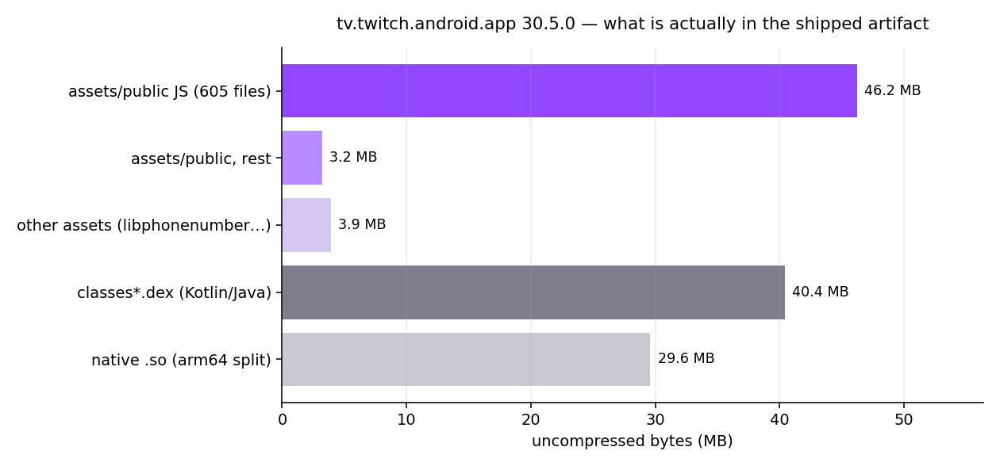
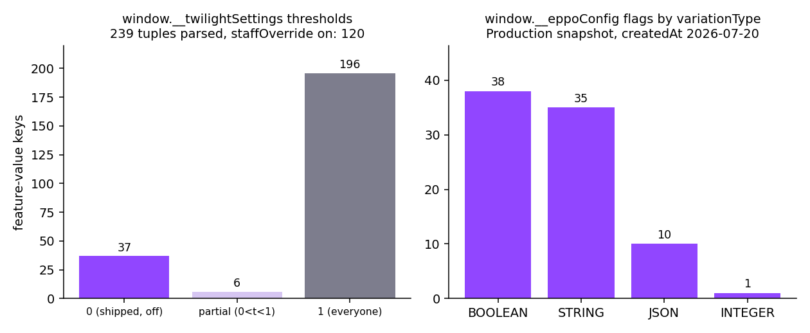
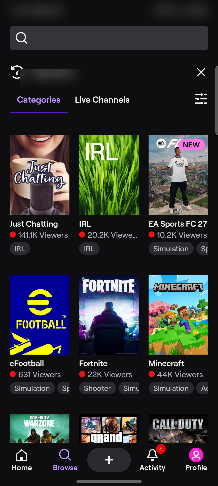

# Twitch switched: the production flag config ships in the APK

**Date:** 2026-10-12
**Category:** web2
**Vuln class:** information disclosure / client-side decision authority (no exploit claimed here, see *What I could not show*)
**Chain/Stack:** Android (`tv.twitch.android.app` 30.5.0), bundled web SPA, Eppo + Twilight feature flags

---

## What happened

I pulled Twitch off my own phone to look at the switching layer, on the theory that a company this deep into
A/B testing has built something worth reading. That theory was correct in a way I did not expect, which is
that the thing worth reading was sitting in the download.

First, the app is not an app. It is a website wearing a phone case, and the case is the smaller part:

| Component | Uncompressed |
|---|---|
| `assets/public/` | 49,409,037 B across 894 files |
| JavaScript inside it | 46,216,500 B across 605 files, 93.5% of that tree |
| All `assets/` | 53,299,052 B |
| `classes*.dex`, every line of Kotlin and Java | 40,415,244 B |
| Native `.so` (arm64 split, 13 libs) | 29,604,848 B |

Read that table again. The bundled web page is bigger than the entire compiled application. The native code is
the packaging.

Four entry points (`portals.html` and its three theater-shaped siblings) bootstrap that bundle, and each one
inlines two configuration objects before any application code runs. Not fetched. Inlined, into the HTML, which
is inside the APK, which is on your phone.

The first object is `window.__eppoConfig`, fed to a vendored `@eppo/js-client-sdk@3.14.1`. It is a build-time
snapshot of the **`Production`** environment, stamped `createdAt:"2026-07-20T19:09:17.097Z"`,
`format:"SERVER"`. Inside: 84 flags I could parse by name (38 boolean, 35 string, 10 JSON, 1 integer, and the
`variations:` token appears 240 times so treat 84 as a floor), 455 `allocation-<id>` entries, 129 targeting
rule sets, and 344 bucketing salts against `totalShards:1e4`.

The salts are the giveaway, because salts are named after the work they bucket, and someone at Twitch has been
repeatedly told by a name generator that the answer is an animal. In the shipped file I have salts shaped like
`<animal>-<animal>-<food>-<id>-split`, one like `<fantasy-realm>-notification-holdout-q1-2026-holdout`, and
several that are plainly `<secret project>-one`. I kept the real list out of this post on purpose. It is in the
APK if you want it, and I would rather not be the reason a holdout group gets burned in a search engine.

Targeting rules come along too, in plaintext, because why not:

```js
allocations:[{key:"allocation-139150",
  startAt:"2026-07-09T22:59:01.251Z", endAt:"9999-12-31T00:00:00.000Z",
  splits:[{variationKey:"<redacted>-acquisition",
    shards:[{salt:"<redacted>-<id>-split",ranges:[{start:0,end:1e4}]}]}], doLog:!1}]
```

```js
rules:[{conditions:[{value:"27.2.0",operator:"GTE",attribute:"app_version"},
                   {value:["ios"],operator:"ONE_OF",attribute:"client_app"}]}, …]
```

The second object is `window.__twilightSettings`, the older system, ~581 keys in a 40 KB blob. Its values are
two-element tuples and the reader helpfully spells out what they mean
(`assets/23151-e953afc1983f733208f3.js`):

```js
isFeatureFlagValue(e){return Array.isArray(e)&&2===e.length&&"boolean"==typeof e[1]&&
  "number"==typeof e[0]&&e[0]>=0&&e[0]<=1}
parseFeatureFlag(e){const[t,i]=e;return{threshold:t,staffOverride:i}}
```

So `[threshold, staffOverride]`, which is a very tidy way of saying "everyone gets this, and staff get it
early". Of the 239 tuples I parsed: 196 at threshold 1, 6 partial, 37 sitting at zero (shipped, switched off,
waiting for someone to press the button), and **120 with `staffOverride` on**. Half the flag surface has a
"but employees first" door in it.

That blob also carries security-shaped values in plaintext: a 2FA remember-me control, a 2FA SMS resend
timeout, a key that pins a 2FA restriction to a two-letter country code, a third-party OAuth token-persistence
switch, and an account-security recommendation flag. I am naming the categories and not the exact keys, because
the categories are the point and the keys are Twitch's to publish.




Here is what that bundle renders, captured off the device the APK came from. Home tab, autoplaying a live
stream with chat; then Browse. Neither is a native Android layout in the ordinary sense, which is the whole
point of the first table.




Both are blurred in three places: the status bar (clock and notification icons), the chat overlay (strangers'
handles), and the search-history row plus my own profile avatar. The unredacted originals stay out of this
repo. `sha256` of the two published frames: `d790e785…ade4` and `bdc987dd…472e`, captured at 1080x2400 with
`rea capture-adb-screen`.

## Why it worked

Not a mistake, mostly. Offline init wants the config present at first paint, so the build bakes the current
production state into the artifact and every client that ships also ships the rollout table.

The part worth arguing about is where the decision gets made. Assignment is computed in JavaScript, from data
the JavaScript already holds. The legacy gate is a client-side FNV-1a hash of your `deviceID` compared to the
threshold, and it short-circuits on a role check that also runs client-side:

```js
return !(!staffOverride || !(store.getState().session.user?.roles?.isStaff)) || <hash(deviceID) vs threshold>
```

That is the shape to notice. The server supplies the truth *and* the code that acts on it, and the acting
happens on the machine with the most incentive to lie. Which, for the record, is your machine. It is always
your machine.

## The switching surface

Both flag systems accept overrides, and both read them from places a user controls.

Eppo's wrapper (`assets/23151-…js`, `getOverridesFromStorage`) reads the cookie store *and the page URL*, and
the URL wins:

```js
const e=readStorage(eppoOverridesKey,"parsed");
let t=null;
const q=queryParse(window.location.search)[eppoOverridesKey];
if("string"==typeof q) t=JSON.parse(q);
…
const validated=schema.validate(t||e)   // url || cookie
```

and in `getAssignment`, an override is returned *instead of* computing the assignment:

```js
const {override:r, subjectKey:o, shouldReturnDefault:a}=this.getAssignmentInfo(…);
if(a) return i;          // default
if(null!==r) return r;   // override wins, no bucketing performed
```

The schema is `{state:{flagVariantOverridesByKey, flagAdditionalVariantsByKey, disabledFlagOverrides},
version:1}`. Flag keys are dynamic, so any flag can be targeted, and `flagAdditionalVariantsByKey` lets a
caller invent a variant value that never existed server-side, including JSON. The legacy system does the same
trick with `?experiments=` plus a cookie and a `getDynamicStaffOverride(id)` reading `expStaff_<id>`. A third
channel shadows feature values straight out of `localStorage`, and both baked blobs get re-hydrated from
`localStorage` whenever the cached timestamp beats the build's `inlineFetchTime`.

Where did the URL format come from? A staff-console component, also shipped:

```js
copySerializedState:"url" →
  origin.replace("www.twitch.tv","main.twitch.tech")
        .replace(/\.twitch\.tv/,"-main.twitch.tech") + pathname + "?eppoOverrides=…"
```

The intended target is an experiment-branch host, not production. Somebody built a "send this to a teammate so
they can see my variant" button, which is a completely reasonable thing to build, and it ended up in the same
bundle as everything else, next to `_DEVTOOL_getRawConfig()`, `_DEVTOOL_hotApplyFlags()` and
`window.__setEppoOverridesCookie()`.

Two things I checked and did **not** find, which matter for how any of this gets rated:

- **Eppo's own override store is disabled.** `enableOverrides` appears only inside the vendored SDK, never at
  a Twitch call site; `initEppoClient()` passes just `{assignmentLogger, flagsConfiguration, isObfuscated:!1}`,
  so `unsetOverrideStore()` runs. Twitch turned off the vendor's override mechanism and then built their own,
  which is the most software-engineering thing I have found all year.
- **No native asset loader.** `AssetLoader`, `WebAppInterface` and `JavascriptInterface` all return zero
  classes, and `TwitchPortalsPlugin` exposes `load/openLink/dispatchEvent/addListener` over R8-renamed types.
  The bridge is there. How it hosts the origin that owns those writable stores is still open.

## What the obvious fix misses

Strip the baked config and first paint goes dark, or every flag reads default and the experiment data
corrupts silently while the UI looks fine. The snapshot is load-bearing.

Delete `?eppoOverrides=` and you have removed one input to a decision that is still made on the client. The
cookie path, the `localStorage` shadow, and the `cachedTime > inlineFetchTime` re-hydration all stay, and they
are the same authority wearing different hats. The control that actually belongs on the server is *assignment*,
and moving it means the client stops being able to render gated UI at first paint at all. That is the real
cost, and it is why nobody pays it.

The salts are the thing people forget. Once `salt`, `entityId` and `totalShards` reach the client, bucketing is
reproducible by anyone who can open a file, so rollout percentages are public before launch and holdout
membership is computable. And you cannot rotate a salt in response to a leak, because rotating the salt
reshuffles every user and destroys the experiment you were protecting. Disclosure here is close to permanent.

The honest counterweight, and I mean this: a user opting themselves into a UI variant is not a breach. It costs
Twitch one contaminated experiment cell, not a session. The severity here is disclosure and experiment
integrity, and it stays there unless some flag gates something that must not be client-decided.

## Where else this pattern exists

Any client-side flag SDK that ships config to the device has the same structural property, which is why
"config-as-data on the client" is a design review item and not a bug-hunting target. What makes this one worth
a post is the specific stack: a baked production snapshot, a URL-reachable override, and a role check evaluated
in JavaScript, all three in one artifact.

Two adjacent shapes in the same bundle, both client-side authority over something security-shaped: a JSON flag
whose value is an origin allowlist for social-auth postMessage restriction, and the 2FA keys above. If either
is enforced only where the config is read, the enforcement point is the client.

I did not get to say that, because I could not show it.

## What I could not show

- That social-auth origin flag appears **only inside the baked data**, in the four `portals*.html` files. Zero
  references in any shipped JavaScript in this artifact. Its consumer lives somewhere else, probably the auth
  bundle twitch.tv serves, possibly native. So "flip the flag in the URL, widen the allowlist, catch a
  postMessage" is an unfunded hypothesis sitting in this post, not a finding, and I am not going to poke
  Twitch production to settle it.
- Everything here is static. JADX never executed the APK, so nothing is proven to *happen*, only to be written.
- APK signature verification came back `not_performed`. The provenance I actually have is "pulled from my own
  device, installer `com.android.vending`, digests recorded", which is not the same sentence as "verified
  against Twitch's signing key".
- Resource claims rest on an apktool decode with `coverage: partial`, 2,000 of 4,939 string entries projected.
- 84 flags is a floor from my own regex, not a vendor number.

## Tooling

`rea-agents@6.4.0` driving `jadx-headless-mcp 0.7.1` and `apktool 3.0.3` on JDK 21. Engine jar pinned to the
digest REA audits (`6e5eacf5…775`), and every pull and decode lands as an evidence bundle with its own
`evidence_id`, target sha256 and provider version.

Two process notes that changed the outcome, both cheap, both easy to skip, one of which I skipped:

1. **Run a control before believing a negative.** My first searches for `RemoteConfig`, `ValueModule` and
   `AccountSwitch` all came back `matches: []`, and I was about to write "Twitch doesn't use those". Then I
   queried `LandingActivity`, a class the manifest *proves* exists, and got 2 hits. `Landing` gave 6. A fully
   qualified name gave 0. The tool matches substrings of the simple class name, so my zeros meant something
   after all, and they would have meant nothing at all if I had not checked. Side note: that control is how I
   found the launcher forwards to `ViewerLandingActivity` rather than staying put.
2. **REA runs one analysis at a time.** I launched a search batch in the background while an apktool decode was
   still running and it cancelled at query 1 with `code: cancelled, retryable: true`, which is a polite way of
   saying you can only have one. Both scripts now refuse to start if a jadx JVM is alive, because I have learned
   nothing else.

`rea doctor` classifies this host as `unsupported_host` (Kali 2026.3; REA supports macOS, Ubuntu, Fedora and
Arch). The ADB and JADX families ran anyway, but nothing here sits inside REA's verified boundary, and anyone
reproducing this should assume the same caveat.

Follow-up candidates: work out which flags the *native* side reads (`cloud.eppo.android` is in the DEX, though
only `EppoInitializationException` survived R8, so the rest is renamed into soup), and settle how the WebView
hosts `assets/public` and which origin owns those `localStorage` stores.

---

*Sources: `base.apk` sha256 `bf0799402506efd5ddec7ad93428096a6118c76c5f6fd408f84c465d2da88e7e`, pulled from
device `R5CR12571PZ` (SM_G991U) via `rea pull-adb-package`, coverage `complete`, digests cross-checked with
`sha256sum`. Analysis artifacts under `~/research/twitch-switched/evidence/`. Twitch 30.5.0 (versionCode
3005006), installed 2026-07-05, updated 2026-07-31. Internal experiment codenames and security-relevant flag
keys are genericized in this post; the strings are in the shipped artifact and I chose not to print them.*
